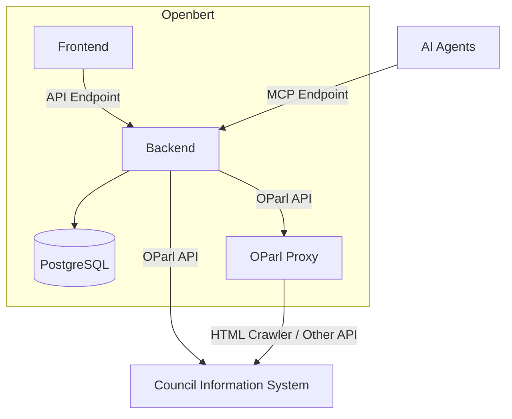
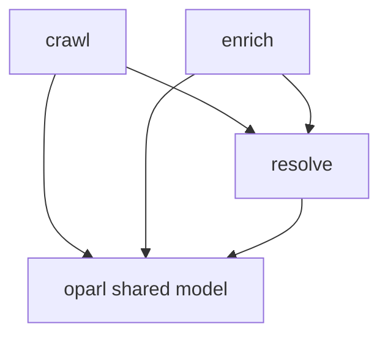
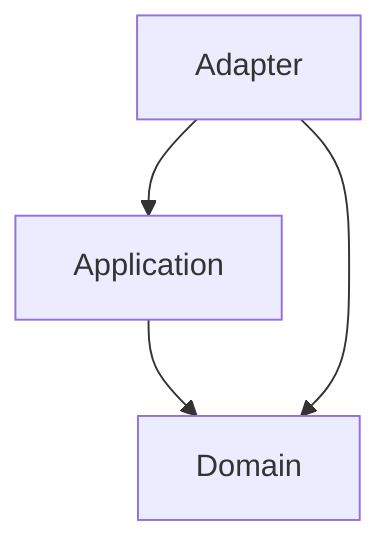

# Openbert – Backend

## Goal of the Openbert Project

Openbert makes data from German council information systems (CIS, German translation: “[Ratsinformationssysteme (RIS)](https://de.wikipedia.org/wiki/Ratsinformationssystem)”) easier to access and use.
Since many of these systems do not provide suitable APIs, Openbert exposes their data through the standardized [OParl API](https://oparl.org).

In the future, the same data will also be exposed through [MCP](https://de.wikipedia.org/wiki/Model_Context_Protocol), making it available to AI applications and agents.
This can enable use cases such as identifying upcoming public tenders early, discovering planned residential development areas, or finding relevant local news and political developments.

Openbert also aims to enrich the original data where useful.
For example, geographic information that is missing from the source system could be extracted or added to make the data easier to search, analyze, and connect with other applications.

## System Architecture

Openbert follows a simple frontend/backend architecture.
The backend exposes all relevant data through APIs that are consumed by the frontend.

An additional component is the OParl Proxy.
It provides data from council information systems through an OParl-compatible API when the source system does not offer OParl support itself.

## Backend Architecture and Software Design Decisions

This project follows the principles of Domain-Driven Design and [Hexagonal Architecture (also known as Ports and Adapters)](https://en.wikipedia.org/wiki/Hexagonal_architecture_(software)).

The codebase is organized into multiple sub-domains to separate different concerns. The current sub-domains are:
- `crawl`, which fetches raw data from remote council information systems.
- `enrich` (planned), which enriches the data (for example by adding geo-locations) and persists the enrichment in dedicated tables.
- `resolve`, which merges raw and enriched data into resolved data that is later presented to users.
- `oparl`, which contains data structures shared between `crawl`, `enrich`, and `resolve`.

The architecture currently uses the following layers:
- `domain`, which contains entities, value objects, and domain services.
- `application`, which contains use cases and ports such as repositories.
- `adapter`, which contains integrations with the outside world, such as repository implementations.

## Getting Started

1. Clone this project.
2. Run `docker compose up -d` in the project directory to start the database.
3. Start the application (which will execute the migrations).
4. Run the [fixtures query](./docs/fixtures.sql) to initialise first system.
