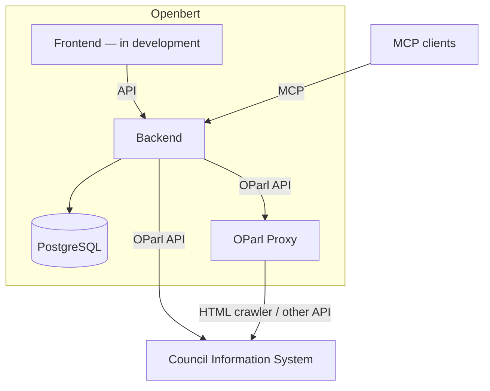
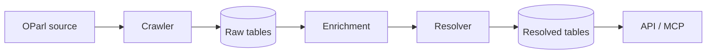

# Openbert – Backend

Openbert makes data from German council information systems (*Ratsinformationssysteme*, RIS) accessible to citizens, council members, and political parties. It collects data through [OParl](docs/oparl/OParl-1.1.md) and exposes it through an API and MCP tools.

This is my personal project: I develop the product idea and write the code.

The longer-term goal is to connect information across municipalities. Planned enrichment, such as geographic information, would help people follow developments beyond their own city—for example, construction businesses tracking what several councils are planning.

## Current status

MCP is the main entry point, with tools for listing councils and searching their data. It can be used with clients such as Claude and LM Studio. A frontend is in development; public hosting is pending authentication. There is no hosted demo yet.

File downloads are implemented: the `access` and `download` endpoints stream the original file content. The OParl implementation is still incomplete: refresh/deletion handling and some relationships remain unfinished.

## System overview

## Implementation

**Kotlin · Spring Boot 4 · Spring MVC · Spring Data JPA · PostgreSQL · Flyway · JobRunr · Spring AI MCP · Testcontainers**

Raw records allow incomplete source relationships. Deterministic location enrichment trims fields, normalizes street abbreviations, and corrects misplaced address and room values. Overrides are stored separately, preserving the source fields. Resolution applies those overrides and builds the relationships used by the API.

The project follows domain-driven design and hexagonal architecture. Code lives under `parldata`: `domain` holds the model, `application` handles resolution and search, and `adapter` contains HTTP, MCP, crawler, and persistence integrations. Entities use JPA annotations and repository ports extend Spring Data. Crawler HTTP requests precede transactional processing; each resolver job has its own transaction. The layer rules are enforced by architecture tests.

## Documentation

- [CONTRIBUTING.md](CONTRIBUTING.md) — how to run, test, build, and deploy the project, and how to contribute
- [AGENTS.md](AGENTS.md) — instructions and standards for AI coding agents
- [docs/GLOSSARY.md](docs/GLOSSARY.md) — domain terminology (German / English)
- [docs/crawling.md](docs/crawling.md) — crawler rules for list representations and embedded objects
- [docs/oparl/](docs/oparl/) — the OParl 1.1 specification and project notes on mandatory resources and URL structure
