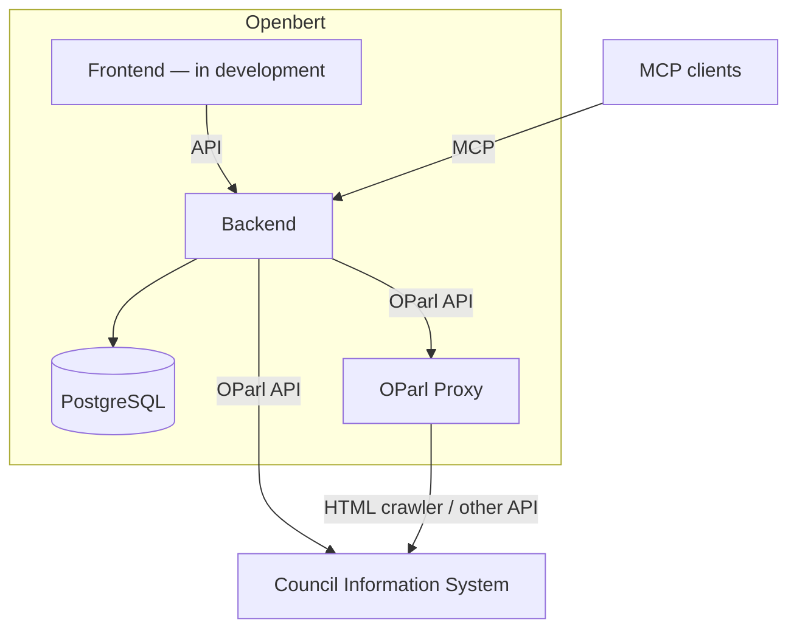
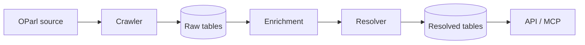

# Openbert – Backend

[](https://github.com/markuspoerschke/openbert-backend/actions/workflows/test.yml)

Openbert makes data from German council information systems (*Ratsinformationssysteme*, RIS) accessible to citizens, council members, and political parties. It collects data through OParl and exposes it through an API and MCP tools.

This is my personal project: I develop the product idea and write the code.

The longer-term goal is to connect information across municipalities. Planned enrichment, such as geographic information, would help people follow developments beyond their own city—for example, construction businesses tracking what several councils are planning.

## Current status

MCP is the main entry point, with tools for listing councils and searching their data. It can be used with clients such as Claude and LM Studio. A frontend is in development; public hosting is pending authentication. There is no hosted demo yet.

The OParl implementation is incomplete: refresh/deletion handling and some relationships remain unfinished, and file downloads currently return placeholders.

## System overview



## Implementation

**Kotlin · Spring Boot 4 · Spring MVC · Spring Data JPA · PostgreSQL · Flyway · JobRunr · Spring AI MCP · Testcontainers**



Raw records allow incomplete source relationships. Deterministic location enrichment trims fields, normalizes street abbreviations, and corrects misplaced address and room values. Overrides are stored separately, preserving the source fields. Resolution applies those overrides and builds the relationships used by the API.

Code lives under `parldata`: `domain` holds the model, `application` handles resolution and search, and `adapter` contains HTTP, MCP, crawler, and persistence integrations. Entities use JPA annotations and repository ports extend Spring Data. Crawler HTTP requests precede transactional processing; each resolver job has its own transaction.

## Run locally

Requires **JDK 25** and **Docker**. From the repository root:

```sh
docker compose up -d
./gradlew bootRun
```

After startup completes and Flyway has created the schema, run this once in another terminal to seed the Krefeld crawl:

```sh
docker compose exec -T postgres psql -U myuser -d mydatabase < docs/fixtures.sql
```

Data availability depends on the upstream server and background processing.

- **MCP:** `http://localhost:8080/mcp` (Streamable HTTP); tools: `oparl_body_list`, `oparl_search`, `oparl_get_resource`.
  Use `oparl_search` or `oparl_body_list` first, then pass the `id` of a result to `oparl_get_resource` to fetch that single resource.
- **API:** [OParl entry point](http://localhost:8080/oparl/v1.1/system).
- **API documentation:** [Swagger UI](http://localhost:8080/docs) to browse and try the HTTP endpoints; OpenAPI schema at `http://localhost:8080/docs/openapi.json`.
- **Tests and packaging:** `./gradlew build` (Docker required for Testcontainers).

## Configuration

Application-specific properties use the `app.` prefix and can be overridden through environment variables using Spring's relaxed binding.

| Property | Environment variable | Default | Description |
| --- | --- | --- | --- |
| `app.crawl.scheduler.enabled` | `APP_CRAWL_SCHEDULER_ENABLED` | `true` | Enables or disables the crawl cronjob. When set to `false`, no crawl targets are processed. |
| `app.crawl.scheduler.cron` | `APP_CRAWL_SCHEDULER_CRON` | `0 * * * * *` | Cron expression for the crawl cronjob (every 60 seconds by default). The special value `-` disables the schedule. |

The crawl runs directly inside the cronjob, so crawls are paced by the cron expression instead of piling up in the JobRunr queue. Only resolve and enrich jobs are still dispatched through JobRunr.

## Static analysis

Run `./gradlew detekt` to analyze production and test Kotlin sources. Detekt also runs through `check` when executing `./gradlew build`, including the CI build. Reports are written to `build/reports/detekt/` in HTML, XML, Markdown and SARIF formats.

Detekt findings fail the build. The project uses Detekt 2.0.0-alpha.6 for compatibility with JDK 25 and Gradle 9.

## Architecture tests

ArchUnit checks production bytecode to enforce dependencies between the domain, application, and adapter layers in each bounded context. Dependencies point inward: domain code cannot depend on application code or adapters, and application code cannot depend on adapters. The root package contains application bootstrap code, which no other layer may depend on. Every production class must belong to one of these layers.

Inbound and outbound ports must be interfaces. Port contracts and their models may depend on domain types and other port contracts, but not on application implementations. Existing JPA annotations, Spring components, and Spring Data repository ports remain supported; the rules constrain dependencies within the backend. Dependencies within the adapter layer are allowed, including crawler access to the OParl client and MCP access to API mappers.

Run `./gradlew test --tests 'nrw.openbert.backend.architecture.ArchitectureTest'` to check the architecture without starting Spring or Docker. These tests also run with `./gradlew test` and the CI `./gradlew build`; violations fail the build. URL persistence uses an automatically applied JPA converter so domain entities do not reference the persistence adapter.

## Docker image

The standalone backend image is built entirely inside Docker, so the build machine does not need JDK or Gradle installed:

```sh
docker build -t openbert-backend .
```

Run the image against a PostgreSQL database by supplying the connection settings at runtime:

```sh
docker run --rm -p 8080:8080 \
  -e SPRING_DATASOURCE_URL=jdbc:postgresql://database-host:5432/openbert \
  -e SPRING_DATASOURCE_USERNAME=openbert \
  -e SPRING_DATASOURCE_PASSWORD=change-me \
  openbert-backend
```

Do not put database credentials in the image, Dockerfile, or repository. The existing `compose.yaml` continues to provide PostgreSQL only for local development; PostgreSQL is not bundled into the backend image.

### Coolify

Configure Coolify to build the repository's root `Dockerfile`, then set:

- Container port: `8080`
- Health-check path: `/actuator/health`
- `SPRING_DATASOURCE_URL`: the external PostgreSQL JDBC URL, for example `jdbc:postgresql://postgres-host:5432/openbert`
- `SPRING_DATASOURCE_USERNAME`: the PostgreSQL user
- `SPRING_DATASOURCE_PASSWORD`: the PostgreSQL password, stored as a secret

JobRunr's dashboard listens on port `8000`. Do not expose or publicly route that port unless the dashboard is separately secured.
