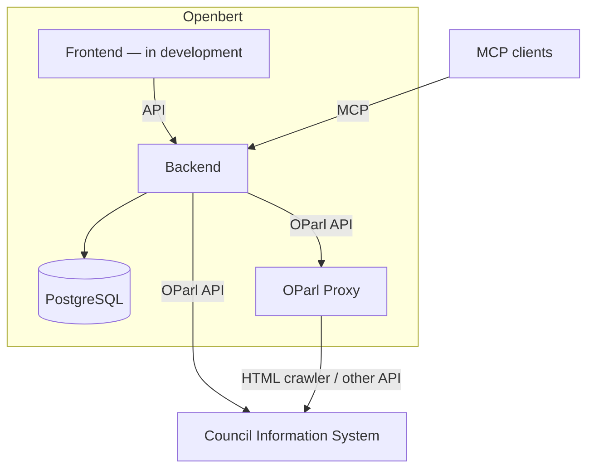
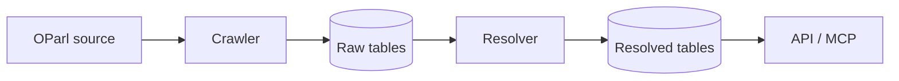

# Openbert – Backend

[](https://github.com/markuspoerschke/openbert-backend/actions/workflows/test.yml)

Openbert makes data from German council information systems (*Ratsinformationssysteme*, RIS) accessible to citizens, council members, and political parties. It collects data through OParl and exposes it through an API and MCP tools.

This is my personal project: I develop the product idea and write the code.

The longer-term goal is to connect information across municipalities. Planned enrichment, such as geographic information, would help people follow developments beyond their own city—for example, construction businesses tracking what several councils are planning.

## Current status

MCP is the main entry point, with tools for listing councils, searching their data, and retrieving individual resources. It can be used with clients such as Claude and LM Studio. A frontend is in development; public hosting is pending authentication. There is no hosted demo yet.

The OParl implementation is incomplete: refresh/deletion handling and some relationships remain unfinished, and file downloads currently return placeholders.

## System overview



## Implementation

**Kotlin · Spring Boot 4 · Spring MVC · Spring Data JPA · PostgreSQL · Flyway · JobRunr · Spring AI MCP · Testcontainers**



Raw records allow incomplete source relationships. Resolution builds the relationships used by the API; separate tables leave room for future enrichment without overwriting source fields.

Code lives under `parldata`: `domain` holds the model, `application` handles resolution and search, and `adapter` contains HTTP, MCP, crawler, and persistence integrations. Entities use JPA annotations and repository ports extend Spring Data. Crawler HTTP requests precede transactional processing; each resolver job has its own transaction.

## Run locally

Requires **JDK 25** and **Docker**. From the repository root:

```sh
docker compose up -d
./gradlew bootRun
```

After startup completes and Flyway has created the schema, run this once in another terminal to seed the Krefeld crawl:

```sh
docker compose exec -T postgres psql -U myuser -d mydatabase < docs/fixtures.sql
```

Data availability depends on the upstream server and background processing.

- **MCP:** `http://localhost:8080/mcp` (Streamable HTTP); tools: `oparl_body_list`, `oparl_search`, `oparl_get_resource`.
- **API:** [OParl entry point](http://localhost:8080/oparl/v1.1/system).
- **API documentation:** [Swagger UI](http://localhost:8080/swagger-ui.html) to browse and try the HTTP endpoints.
- **Tests and packaging:** `./gradlew build` (Docker required for Testcontainers).

To retrieve a resource over MCP, pass its full `id` URL from `oparl_search` or `oparl_body_list`
unchanged to `oparl_get_resource` as `{"id": "<returned id>"}`. The tool determines
the resource type and body from that single ID and returns the same OParl representation as
the API. Individual relationship IDs can be followed the same way, including IDs of embedded
objects. Collection URLs and file access/download URLs are not resource IDs. Malformed,
unsupported, missing, or incorrectly scoped IDs produce MCP tool errors.

## Docker image

The standalone backend image is built entirely inside Docker, so the build machine does not need JDK or Gradle installed:

```sh
docker build -t openbert-backend .
```

Run the image against a PostgreSQL database by supplying the connection settings at runtime:

```sh
docker run --rm -p 8080:8080 \
  -e SPRING_DATASOURCE_URL=jdbc:postgresql://database-host:5432/openbert \
  -e SPRING_DATASOURCE_USERNAME=openbert \
  -e SPRING_DATASOURCE_PASSWORD=change-me \
  openbert-backend
```

Do not put database credentials in the image, Dockerfile, or repository. The existing `compose.yaml` continues to provide PostgreSQL only for local development; PostgreSQL is not bundled into the backend image.

### Coolify

Configure Coolify to build the repository's root `Dockerfile`, then set:

- Container port: `8080`
- Health-check path: `/actuator/health`
- `SPRING_DATASOURCE_URL`: the external PostgreSQL JDBC URL, for example `jdbc:postgresql://postgres-host:5432/openbert`
- `SPRING_DATASOURCE_USERNAME`: the PostgreSQL user
- `SPRING_DATASOURCE_PASSWORD`: the PostgreSQL password, stored as a secret

JobRunr's dashboard listens on port `8000`. Do not expose or publicly route that port unless the dashboard is separately secured.
